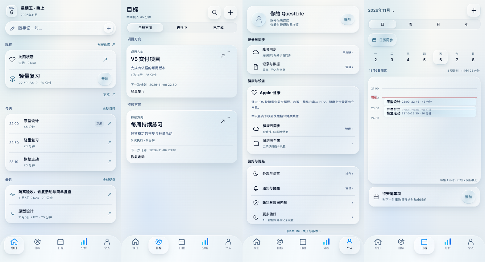

# 第五版第三轮：今日重做、分析图表与界面收尾

2026-11-06，执行目录 `/Users/kyrie/dev/QuestLife`，分支 `feature/v5-ui`。

## 入口与结论

- 固定候选入口：<https://questlife-v1-release.vercel.app/>，不需要 feature flag。
- 本次部署源码：`9e38be03aa4011ca4ac48df845b7f6fbb20592b9`。
- 独立部署：<https://questlife-v1-release-a1d9aphxu-kyrie-z-s-projects.vercel.app>。
- 部署 ID：`dpl_9D1XPPBejLh5SQxiswRg5C83wnpr`。Ready 与固定入口 `version.json` 已核对。
- 旧正式项目 `questlife-alpha`、旧 Owner 数据库、main 分支及正式别名未切换。Vercel 回执中的 Production 指的是**候选项目自身的固定环境**，不是旧正式项目。
- 结论：本轮 Web 展示改动和指定的匿名正常界面验收已完成；下文列出的云端、设备和部分条件态未完成验收。不据此宣布完整产品或视觉审美验收通过。
- 107 张浏览器截图 + 1 张四屏并排图，见 `screens/`。393×852 为主，另查 375×667、1280×900；这是 macOS Chrome 浏览器验证，不是真机 Safari。



## 1. 仓库安全逐项结果

| 要求 | 结果 | 证据与限制 |
|---|---|---|
| 应用 Git 文件完整读取、fsck | 完成 | 737/737 文件、127,535,408 字节；原位置及独立 clone 的 fsck 均返回 0，无缺失或损坏对象。dangling 提示不是缺失。 |
| 未推送分支备份 | 完成 | 8 个分支非强制、原子推送；71 个未发布提交的允许范围预检，无新增受限路径或秘密模式。清单见 `01_仓库安全.md`。 |
| 不动 main | 完成 | 没有推送/改写 main；备份前记录远端为 `c8c4387f302af5ef7dd05eaab2d177f6a000447b`，最终远端核对另存 `qa/git-backup.txt`。 |
| iCloud 外独立应用仓库 | 完成 | `/Users/kyrie/dev/QuestLife`，24 个分支，独立 Git 对象；依赖复用旧 worktree 的 node_modules，不是重新下载的副本。 |
| 旧目录和用户修改保留 | 完成 | 原目录、旧 worktree 均未删除或移动。五个修改文件开始/结束 SHA-256 全部一致，见 `qa/main-preservation-final.json`。 |
| Quant 本地备份 | 完成，但原路径 fsck 有环境限制 | 1446/1446 文件完整读取；原路径直接 fsck 300 秒超时。1391 个对象复制后 SHA 一致，以原 refs/index 和本地对象副本校验返回 0；完整镜像和新 clone 再次 fsck 均返回 0。没有改写/修复历史。 |
| Quant 新位置 | 完成 | `/Users/kyrie/dev/QuestLife-Quant`，10 个分支，无远端、不推送；原目录保留。 |
| 新目录一键部署 | 完成 | 部署脚本以当前目录为根；在新位置完整运行 `npm run deploy:candidate`，锁定候选项目 ID 和公开编译出的候选 Supabase 地址。 |
| 安全文档 | 完成 | `01_仓库安全.md` 与 `safety/` 原始结果。未读取受限 Quant 文档或环境变量值。 |

五个保留文件：`docs/release/V1_COMPLETION_LEDGER.md`、`src/native/NativeSettings.test.cjs`、`src/screens/HomeScreen.tsx`、`src/utils/todayCommand.ts`、`tests/native/todayCommandWork.test.cjs`。它们仍留在原主目录，未代用户处理。

## 2. 今日

| 要求 | 结果 | 对应界面/验证 |
|---|---|---|
| 移除大标题大卡、改紧凑分组 | 完成 | 日期、记录框、现在、今天、最近；主动作字号 17px，日期数字同步降为 17px。普通行 56–64px；长英文动作允许换行，不强制裁切标题。 |
| 状态两排五档、自动保存收起 | 完成 | 正常点选精力、紧绷后保存；刷新仍在。截图 08、09、10。原保存 ACK/重试接口未更换。 |
| 过载、依据、纠正入口 | 完成 | 真实操作得到过载状态，并通过原 Sheet 查看依据、纠正；截图 10、62、63。 |
| 超过三小时弱化 | 展示逻辑完成，浏览器自然等待未验证 | 沿用记录时间判断；没有篡改时钟或注入旧状态来制造截图。 |
| 唯一 todayCommand 主动作 | 完成 | 不新建决策器；原型设计开始、进行中完成、反馈入口、无数据记一句等均复用原回调。截图 09、12、90。 |
| 不匹配提示、调整、确认、撤销 | 完成 | 过载 + 深度任务显示建议；无可用容量时阻止确认。另通过正常创建一个临时安排得到可确认预览，Apply 后检查时间，Undo 后检查恢复，截图 11、67–69。 |
| 完成的分钟、难度、备注 | 完成 | 25 分钟、更难、备注通过原 Finish 提交；另建 20 分钟自定义执行、质量 4。刷新后两个执行仍在。截图 13–17。 |
| 自然到期回访 | 完成 | 没有改时间；两个动作在现有 20 分钟资格到期后先后出现。分别选择精力 4、3，保存回各自原状态 ID；刷新均保留，不再显示已答项。截图 77、78、82；ID 证据在 `qa/isolated-browser-result.json`。快捷指令 25 分钟提醒文案沿用原设置，不改变回访资格。 |
| 今天最多三行、最近最多三条 | 完成 | 当前 3 项计划、2 条执行，历史仍通过原入口打开；空记录组隐藏。截图 90、103。 |
| 用户可读文案 | 完成 | 去除状态路径中的“签到”；修正主按钮内部 key、Capture 状态分类名和证据字段名的直接显示，未改变存储值。 |

## 3. 目标

| 要求 | 结果 | 证据 |
|---|---|---|
| 17–20px 标题、实际周投入、无数据不补数值 | 完成 | 截图 91 与 104；沿用已有执行归属，不创造进度算法。 |
| 紧凑空分组及项目/习惯模板 | 完成 | 两种模板都经正常界面开始创建，保存为两个独立目标。 |
| 有数据紧凑列表 | 完成 | 名称、上下文、完成条件、投入、下次安排沿用现有结果；截图 91。 |
| 详情、创建、编辑、模块、技能、完成条件 | 展示完成，可达表单已截图 | 45–52；技能编辑里设置需要深度状态并保存，Today/计划标签同步显示。没有批量修改 Owner 目标。 |

## 4. 分析

| 要求 | 结果 | 证据/限制 |
|---|---|---|
| 主图、变量、范围、四种视图、四格读数、五个工具 | 完成 | 94、19–24、32–34。现有图表组件、分析方法和资格规则复用。 |
| 一个或两个真实观察即可画图 | 完成 | 质量 1 点、执行 2 点均实际显示；39 项 V5 测试含 1/2 点、缺失值、删除、未来记录、单位和来源测试。 |
| 零数据变量使用明确示例 | 完成 | 专注、步数、睡眠、心率零记录时，图表/读数/分析都标示例。示例只留在展示层，未写入 AppData；26–29、106。 |
| 不混真实和示例 | 完成 | 精力 4 条、紧绷 4 条、时长 2 条、质量 1 条只使用这次 UI 录入的数据；无个人 baseline 或虚假趋势结论。 |
| 默认变量按实际观察数 | 完成 | 本次精力与紧绷同为 4 条时精力保持首选；定向测试覆盖步数最多时选步数。 |
| 无状态日历、精力/紧绷折线 | 完成 | 当前分析界面不再用状态日历；94、25。 |
| 中性 K 线 | 保留实现；本次匿名会话未验证有资格的真实 K 线 | 继续由 artifact 决定支持类型，不由前端制造 OHLC。无 candle artifact 时只显示支持的折线/单点，不能为了截图伪造个人 K 线。 |
| 缩放、范围、全屏、复位与键盘退出 | 完成 | 浏览器操作，32、100；全屏限制焦点并支持 Escape，关闭后回原工作区。 |
| 本地日期时间一致 | 完成 | 截图发现 UTC 横轴与记录页不一致；只补刻度格式化，夏令时/跨日测试通过。最终 94 横轴为 21:19–21:30，与历史一致；时间戳未改。 |
| 账号分析/云端模型 | 未完成本轮验收 | 按指令不用登录；界面明确“本机观察已显示；账号分析需要登录”，不把账号未连接写成没有数据。 |

`observationPresentation.ts` 只投影已有字段、选择现有结果和隔离示例；不创建 readiness、baseline、资格统计或模型结果。`dataProvenance.deleted`、非法单位、未来时间、不存在的值均不补成 0。最新本机观察不能被更早 artifact 隐藏。

## 5. 界面截图清单

下表“已统一”指本次覆盖到的 Web 展示路径；不是云端、系统授权或真机功能已通过。01–89 为本轮逐次修正过程证据；90–107 为最终源码 `9e38be0` 部署后截图。72 的旧按钮文案、76 的内部分类、42 的重复设置、18 的 UTC 轴分别由 98、79、87、94 取代，不作为最终样式。

| 界面 | 状态 | 截图 |
|---|---|---|
| 首用欢迎、三问 | 已统一 | 101、102 |
| 空今日/目标/日程/分析/个人 | 已统一 | 103–107，每页一张 |
| 今日正常、过载建议、进行中 | 已统一 | 09、10、12 |
| 今日最终浅色/深色 | 已统一 | 90、98 |
| 状态展开、依据、纠正 | 已统一 | 08、62、63 |
| 判断依据 | 已统一 | 81 |
| Capture 输入、加载、错误 | 已统一 | 60、75、61；最终英文 85 |
| Capture 现有本地状态候选确认 | 已统一 | 79，明示不是 AI 成功解析 |
| AI 成功后的多项候选/实体分配确认 | 未完成运行截图 | 匿名会话不放行 AI；共享样式已作用于组件，但没有用模拟响应冒充成功 |
| 调整受阻、可确认、已应用、已撤销 | 已统一 | 11、67、68、69 |
| 清空脑子、逐条决定 | 已统一 | 64、65 |
| 到期回访、保存 | 已统一 | 77、78、82 |
| 执行完成、反馈详情、历史、Direct Log | 已统一 | 13、14、15、16、17 |
| 目标列表/创建/详情/编辑/条件/模块创建 | 已统一 | 91、45、46、47、48、49 |
| 技能创建/详情/编辑及需要状态 | 已统一 | 50、51、52 |
| 日程操作/编辑/创建 | 已统一 | 53、54、55 |
| 日/周/月/年 | 已统一 | 93、56、57、58 |
| 待安排入口 | 已统一 | 89；沿用添加计划，不新增第二套待办存储 |
| 精力/紧绷/专注/步数/睡眠/心率/时长/质量 | 已统一 | 94、25、26、27、28、29、30、31 |
| 比较/指标/方法/解读/历史 | 已统一 | 19、20、21、22、23 |
| 变量选择、全屏、分布、相关 | 已统一 | 24、32、33、34、100 |
| 个人主页/账号/记录与数据 | 已统一 | 92、88、37 |
| 健康同步/外观/提醒/隐私/更多偏好/关于 | 已统一 | 38、39、40、41、87、43 |
| 快捷指令网页 | 已统一 | 70；接收服务未安装，见限制 |
| 离线 | 已统一、缓存后重载可用 | 71；不是首次无网络也能加载 |
| 英文、375 宽与底部滚动 | 已验证显示 | 83–86；最后一条记录底部 557px，导航在其下，无横向溢出 |
| 1280 桌面图表/今日/Capture | 已验证显示 | 95、96、97 |
| 减弱动态偏好下图表全屏 | 已验证交互 | 100 |
| 四个主页面并排 | 已交付 | 108 |

每张截图的时间、URL、视口及横向溢出检查见 `qa/screenshot-manifest.json`。截图为正常点击/填写后的界面，不通过 DOM 注入或导入记录造状态。

## 6. 上轮四个小问题

1. **完成**：日程打开定位当前时间；最终实测当前线距离时间轴可视区上沿 55.8px，即使接近晚间也保留滚动尾部。
2. **完成**：本轮可达界面统一使用 iOS，不使用 IOS。
3. **完成**：深色底栏两端额外边界移除；98、99。
4. **完成**：添加入口采用小胶囊/主色文字；目标模板、创建、日程和待安排入口均可操作。

验收额外发现并修复：V5 日程点击事件后设置了 actionBlock，但原动作 Sheet 只允许原生平台渲染。现已仅对 V5 Web 开放原 Sheet，编辑/移动/删除仍走原 handler；未开放原生系统 Calendar 写入按钮到 Web。修复前失败测试 `qa/schedule-red.log.gz`，修复后相关测试通过。

## 7. 正常界面验收与数据边界

**已在真实部署 Web UI 实测**：全新匿名 Chrome context，不登录、不导入、不注入记录。另一全新匿名 context 用于空状态。两者与 Owner 浏览器会话隔离。

有数据会话最终保留：项目目标「V5 交付项目」、习惯目标「每周持续练习」；3 项计划「原型设计」「轻量复习」「恢复走动」；4 次状态（包含正常和过载；要求至少 3 次）；2 次执行（25 分钟 Finish、20 分钟 Direct Log）。测试多记一次过载是为调整验证，没有把这些测试观察送入 Owner 数据集。

- 创建目标 → 建技能关联 → 创建计划 → 编辑恢复计划时间 → 刷新，结果保留。
- 状态两档选择 → 自动保存收起 → 依据/纠正 → 刷新，正确记录保持。
- Start → running → Finish 填分钟/难度/备注 → 原执行反馈 → 历史 → 刷新，2 条执行 ID 不变。
- 调整预览 → 明确确认 → 检查计划移动 → Undo → 检查原时间恢复。
- 两个到期动作回访分别写入各自状态 ID，刷新后仍分别为 4 和 3，未生成虚假的个人效果结论。
- 新建的临时「调整验收临时计划」仅用于调整容量验收，之后经 Delete 确认删除、刷新不再出现；3 个指定计划仍在。
- 失败 Capture 的「整理文档 12 分钟，完成验收清单」「候选加载状态检查」「现在状态有点紧绷」已逐条经正常删除确认清理；没有留下其执行记录。没有向 Owner 数据库执行删除。
- 离线试验是已加载候选站后断网、重载，已有本机页面与离线反馈可达，再恢复网络刷新。未宣称在线 AI 离线可用。
- 审阅会话中的指定 QA 目标/计划/状态/执行保留用于截图，属于隔离匿名本机数据；不会出现在用户已有浏览器账户。再次访问空浏览器时看到的是正常空状态。

## 8. 命令与结果

| 命令 | 结果 | 日志 |
|---|---|---|
| `npx tsc --noEmit` | 退出 0 | `qa/typecheck.log`（无输出）；最终部署也再次执行 |
| `node --test tests/v5/*.test.cjs` | 39/39，通过 | `qa/v5-tests.log` |
| 定向 5 个 native/Web 集成测试文件 | 72/72，通过 | `qa/integration-tests.log` |
| `npm run test:state-layer` | 157 checks，通过 | `qa/state-tests.log` |
| `npm run test:insights-v3` | 展示、个人层、watchlist、分析扩展边界及 feature selection 命令退出 0 | `qa/insights-tests.log` |
| `npm run deploy:candidate` | 类型、API 类型、Web export、上传检查、候选部署及版本核对均退出 0 | `qa/final-deploy.log.gz`、`qa/deployment-receipt.json` |
| `git diff --check` | 通过 | 完成时执行 |
| 全仓库测试、原生构建、真机性能 | 未运行 | 本轮为 V5 Web 展示收尾，不用全量重建代替界面验收 |
| lint | 未运行 | 仓库没有 lint script，本轮不添加新 lint 工具链 |

定向集成命令：

```sh
QUESTLIFE_UI_TEST_RUNTIME=/tmp/questlife-v5-round3-test-runtime/node_modules node --test tests/native/scheduleUi.test.cjs tests/native/statePlanSubmission.test.cjs tests/native/todayHistoryEntry.test.cjs tests/native/todayCommandWork.test.cjs tests/native/captureActivityKinds.test.cjs
```

测试运行时 React/renderer 依赖安装在仓库外的隔离目录，未改变产品依赖。首次缺该测试依赖与后续 Web 分支 `window` 访问失败均保留在 `/tmp/questlife-v5-round3-integration-tests.log`、`/tmp/questlife-v5-round3-integration-green.log`；后者定位后使用已有 `v5Web` 安全判断修复，不删测试。

横轴修正前两个新增用例失败，原始日志 `qa/chart-time-red.log`；修复后归入 39 项通过结果。运行截图也确认了 UTC → 本地显示修正。

中间一次 CLI 因代理连接中断未收到部署回执，日志 `qa/intermediate-network-failure.log`；之后 inspect 证实那次部署其实 Ready。最后 `9e38be0` 的完整部署命令已成功，不拿中间错误当成成功。

两个带终端尾随空白的原始日志以 gzip 无损保存，避免把原始输出当作代码空白错误；解压后字节与 `/tmp` 原日志一致。

## 9. 控制台、未完成与风险

- 最终五页/重载采样：0 个未捕获 pageerror，0 个 console error；3 类 warning 仍在：Expo Web push token 监听不受支持、Supabase auth lock 选项弃用、React Navigation 对象形式 navigate 弃用。它们没有被隐藏，也未为本次样式任务改动鉴权/导航架构。
- **UNVERIFIED：匿名之外的 AI 解析成功、实体分配完整确认、登录后云端分析与跨设备同步。** 本次严格不用后台账号、不放开 AI 同意、不伪造响应。Capture 的保留原文、加载、错误、重试入口、本地状态候选已验证，不能等同于 `/api/parse` 成功。
- **UNVERIFIED：快捷指令接收端真实写入。** 候选 SQL `202611050001` 尚未安装；本轮明令不执行 migration。设置/指南已统一，但 token 与健康/日历上传不能写成已接通。
- **UNVERIFIED：物理 iPhone Safari、软键盘、系统通知、HealthKit/Calendar、签名安装及性能。** 本轮不安装设备、不新增费用。
- **UNVERIFIED：三小时自然过期、真实成熟 K 线 artifact、备份文件选择后的导入/恢复。** 相应现有能力和 UI 保留，但没有用造数据或导入来替代指定匿名验收。
- 更多偏好、Skill Detail 的结构仍使用现有内容和功能折叠；表面、控件、间距已统一，没有为一致外观重写底层业务。这与“所有页面都重新设计/所有功能都已云端验证”不同。
- 没有执行全量产品回归；以上证据仅适用于列明的 V5 Web 路径。原生包、旧正式站没有更新。

## 10. 改动与备份版本

运行时改动集中于 V5 surfaces、`round3.css`、现有 Sheet/表单的稳定样式属性、现有 Goal/Skill/Schedule 展示入口、图表时间标签与只读观察投影。没有改 HomeScreen、Store、schemas、Sync、Quant 引擎、API 或持久化协议。

- 新文件：`src/v5/round3.css`、`src/v5/observationPresentation.ts`、`public/shortcuts-v5.css`、两份 V5 定向测试及本轮文档/截图。
- 主要展示文件：`TodaySurface.tsx`、`StateStrip.tsx`、`GoalsSurface.tsx`、`InsightsSurface.tsx`、`PersonalSurface.tsx`、`ScheduleSurface.tsx`、`ShortcutSettings.tsx`。
- 原组件衔接：`BottomSheetForm`、`GoalForm`、`SkillForm`、`NativeFormDisclosure`、Quest 控件、Capture 和 Decision Details；`App.web.tsx` 载入 V5 样式。
- `copy.ts` 新增 13 个 zh/en 对应 key；沿用 V5 现有双语辅助方式。状态层只是替换旧“签到”文案。

| 提交 | 内容 |
|---|---|
| `67be1fa` | 仓库保护、iCloud 外新仓库、安全记录 |
| `cdc3dad` | 今日紧凑分组、目标模板、表单和二级页面统一 |
| `69112fb` | 真实观察直接画图、零数据隔离示例和测试 |
| `d3cfb3c` | 导出 Web 的稳定样式选择属性 |
| `b1b261f` | Sheet 操作区、控件、图表全屏焦点 |
| `825bd61` | V5 Web 事件接通原日程操作 Sheet |
| `d104ab2` | 第一批部署后正常界面证据 |
| `2c38562` | 二级设置去重、动作可读文案、安全 Web 判断 |
| `81e70f6` | 图表/目标/日程/个人完整截图 |
| `faec34c` | Capture 与判断依据字段名、Today 字号收口 |
| `9e38be0` | 横轴本地时间、定向测试、自然回访证据；线上源码版本 |

报告/最终截图作为其后的仅文档提交推送 `feature/v5-ui`，不因为文档变化再构建一次。最终 Git 提交及远端对照见 `qa/git-backup.txt` 和交付回复。

## 停止点

本轮到此停止，交由 Claude 按截图和上述未完成清单审阅。未执行主版本互换、正式上线、设备更新、数据库迁移或下一轮开发。
